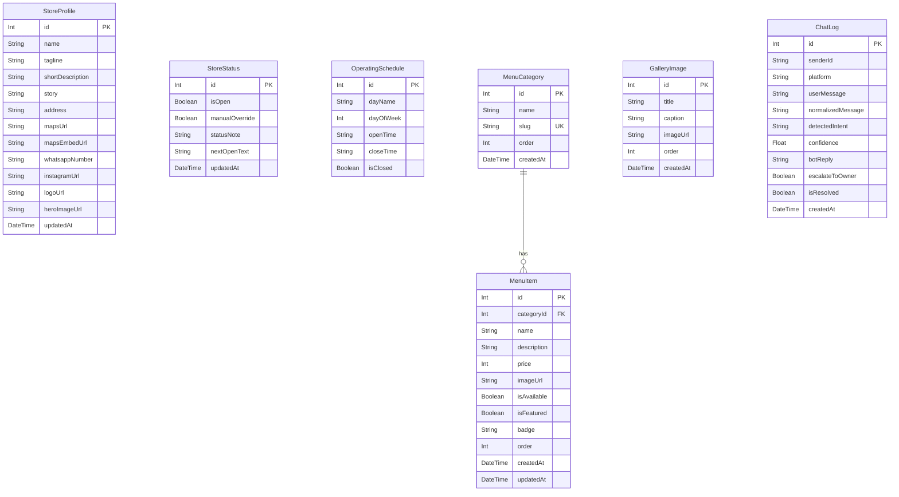

# Entity Relationship Diagram (ERD)

Dokumentasi rancangan database SQLite (Prisma ORM) untuk sistem **Mie Ayam Surabaya**.

## Ringkasan Tabel

1. **Profil & Operasional Toko**
   - `StoreProfile`: Informasi identitas warung (nama, tagline, cerita, alamat, link Maps, nomor WhatsApp, Instagram).
   - `StoreStatus`: Status buka/tutup real-time (`isOpen`, `manualOverride`, `statusNote`, `nextOpenText`) untuk halaman publik dan *live grounding* chatbot.
   - `OperatingSchedule`: Jadwal operasional harian (Senin–Minggu, jam buka/tutup, flag libur).
2. **Katalog Menu & Galeri**
   - `MenuCategory` & `MenuItem`: Daftar kategori dan menu makanan/minuman beserta harga, ketersediaan (`isAvailable`), dan badge.
   - `GalleryImage`: Aset gambar dokumentasi/hidangan.
3. **Chatbot Auto-Reply**
   - `ChatLog`: Menyimpan riwayat percakapan dari Web Chat Widget maupun WhatsApp Webhook (`senderId`, `platform`), hasil normalisasi slang (`normalizedMessage`), prediksi intent (`detectedIntent`, `confidence`), balasan bot (`botReply`), serta flag eskalasi keluhan ke pemilik (`escalateToOwner`, `isResolved`).

